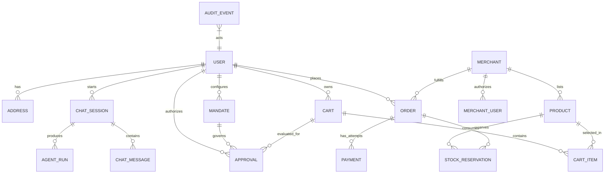

# CartPilot — Database Schema & Relationship Design

This document details the MongoDB data models, relationships, indexing strategies, concurrency handling, and schema designs.

---

## 1. Entity-Relationship Diagram



---

## 2. Core Architectural Decisions for Persistence

1. **Integer Paise Representation:** All currency amounts (`pricePaise`, `subtotalPaise`, `taxPaise`, `deliveryFeePaise`, `totalPaise`, `budgetPaise`) are stored as strictly positive integers. No floating point numbers exist in schemas.
2. **Order Snapshots:** Orders do **not** rely on relational joins to products at purchase time. Products, unit prices, package sizes, merchant details, applied mandates, and delivery addresses are frozen as embedded subdocuments inside the `Order` record.
3. **Cart Versioning:** Every cart mutation increments an integer `version`. Approvals link to this specific integer version.
4. **Ephemeral Reservations with MongoDB TTL:** Active inventory reservations are stored in `StockReservation` with a MongoDB TTL index on `expiresAt` alongside an explicit sweeper worker to release expired inventory safely.
5. **Idempotency Collections:** A unique index on `ProcessedWebhookEvent.eventId` and `Payment.gatewayOrderId` prevents duplicate state execution.
6. **Append-Only Audit Ledger:** `AuditEvent` records have strict indexing on `sequenceNumber` (unique ascending) and forbid update/delete mutations.

---

## 3. Detailed Data Models & Mongoose Schemas

### 3.1. `User` & `Address`

```typescript
interface IUser {
  _id: ObjectId;
  email: string; // Unique, lowercase, indexed
  passwordHash: string;
  name: string;
  role: 'CUSTOMER' | 'MERCHANT' | 'ADMIN';
  phone?: string;
  isActive: boolean;
  refreshTokenHash?: string;
  createdAt: Date;
  updatedAt: Date;
}

interface IAddress {
  _id: ObjectId;
  userId: ObjectId; // Indexed
  label: string; // "Home", "Office"
  street: string;
  city: string;
  state: string;
  postalCode: string;
  country: string;
  isDefault: boolean;
  createdAt: Date;
}
```

### 3.2. `Merchant` & `MerchantUser`

```typescript
interface IMerchant {
  _id: ObjectId;
  businessName: string;
  slug: string; // Unique, indexed
  contactEmail: string;
  contactPhone: string;
  isActive: boolean;
  rating: number; // 0.0 - 5.0
  createdAt: Date;
  updatedAt: Date;
}

interface IMerchantUser {
  _id: ObjectId;
  userId: ObjectId; // Ref User, indexed
  merchantId: ObjectId; // Ref Merchant, indexed
  role: 'OWNER' | 'MANAGER' | 'STAFF';
  createdAt: Date;
}
// Compound Unique Index: { userId: 1, merchantId: 1 }
```

### 3.3. `Product` & `StockReservation`

```typescript
interface IProduct {
  _id: ObjectId;
  merchantId: ObjectId; // Ref Merchant, indexed
  name: string;
  slug: string;
  description: string;
  category: 'GRAINS' | 'PULSES' | 'DAIRY' | 'VEGETABLES' | 'SPICES' | 'OILS' | 'CONDIMENTS';
  pricePaise: number; // Integer paise
  packageSize: number; // e.g., 500
  packageUnit: 'G' | 'KG' | 'ML' | 'L' | 'PIECE';
  availableStock: number; // Checked & decremented atomically
  reservedStock: number; // Active reservations
  aliases: string[]; // e.g. ["paneer", "cottage cheese"] -> Indexed for text/wildcard search
  isVegetarian: boolean; // Must be true for initial catalog
  isActive: boolean;
  createdAt: Date;
  updatedAt: Date;
}
// Text Index: { name: 'text', description: 'text', aliases: 'text' }

interface IStockReservation {
  _id: ObjectId;
  userId: ObjectId;
  cartId: ObjectId;
  items: Array<{
    productId: ObjectId;
    quantity: number;
  }>;
  status: 'ACTIVE' | 'CONSUMED' | 'EXPIRED' | 'RELEASED';
  expiresAt: Date; // TTL index: { expireAfterSeconds: 0 }
  createdAt: Date;
}
```

### 3.4. `Cart`

```typescript
interface ICartItem {
  productId: ObjectId; // Ref Product
  quantity: number; // Min 1
  addedAt: Date;
}

interface ICart {
  _id: ObjectId;
  userId: ObjectId; // Indexed, unique for active cart
  items: ICartItem[];
  version: number; // Monotonically increasing integer
  status: 'ACTIVE' | 'CONVERTED' | 'ABANDONED';
  updatedAt: Date;
  createdAt: Date;
}
```

### 3.5. `Mandate` & `Approval`

```typescript
interface IMandate {
  _id: ObjectId;
  userId: ObjectId; // Unique indexed
  version: number; // Increments on mandate update
  maxOrderAmountPaise: number; // e.g. 60000 = ₹600
  dailyBudgetPaise: number; // e.g. 150000 = ₹1500
  allowedMerchantIds?: ObjectId[]; // Empty means all permitted
  blockedCategories?: string[]; // e.g. ["ALCOHOL", "CONFECTIONERY"]
  requireExplicitApproval: boolean; // If true, always require human sign-off
  isActive: boolean;
  updatedAt: Date;
}

interface IApproval {
  _id: ObjectId;
  userId: ObjectId;
  cartId: ObjectId;
  cartVersion: number;
  mandateVersion: number;
  calculatedTotalPaise: number;
  approvalHash: string; // SHA256(userId + cartId + cartVersion + totalPaise + mandateVersion)
  status: 'PENDING' | 'APPROVED' | 'REJECTED' | 'EXPIRED' | 'INVALIDATED';
  expiresAt: Date;
  decidedAt?: Date;
  createdAt: Date;
}
// Compound Index: { userId: 1, cartId: 1, status: 1 }
```

### 3.6. `Order` & `Payment`

```typescript
interface IOrder {
  _id: ObjectId;
  orderNumber: string; // e.g. "CP-20261010-0012"
  userId: ObjectId; // Indexed
  merchantId: ObjectId; // Primary fulfillment merchant
  status:
    | 'PENDING_PAYMENT'
    | 'PAID'
    | 'CONFIRMED'
    | 'PACKING'
    | 'OUT_FOR_DELIVERY'
    | 'DELIVERED'
    | 'CANCELLED'
    | 'FAILED'
    | 'REFUNDED';

  // Immutable Purchase Snapshots
  items: Array<{
    productId: ObjectId;
    name: string;
    category: string;
    unitPricePaise: number;
    quantity: number;
    subtotalPaise: number;
    packageSize: number;
    packageUnit: string;
  }>;
  pricingSnapshot: {
    subtotalPaise: number;
    deliveryFeePaise: number;
    taxPaise: number;
    totalPaise: number;
  };
  shippingAddressSnapshot: {
    street: string;
    city: string;
    state: string;
    postalCode: string;
  };
  approvalSnapshot?: {
    approvalId: ObjectId;
    approvalHash: string;
  };
  reservationId?: ObjectId;
  paymentId?: ObjectId;
  placedAt: Date;
  deliveredAt?: Date;
  createdAt: Date;
  updatedAt: Date;
}

interface IPayment {
  _id: ObjectId;
  orderId: ObjectId; // Indexed
  userId: ObjectId;
  amountPaise: number;
  currency: 'INR';
  gateway: 'RAZORPAY';
  gatewayOrderId: string; // razorpay_order_id, Unique Indexed
  gatewayPaymentId?: string; // razorpay_payment_id
  gatewaySignature?: string;
  status: 'CREATED' | 'PENDING' | 'PAID' | 'FAILED' | 'EXPIRED';
  failureReason?: string;
  createdAt: Date;
  updatedAt: Date;
}

interface IProcessedWebhookEvent {
  _id: ObjectId;
  eventId: string; // Unique indexed
  eventType: string;
  processedAt: Date;
}
```

### 3.7. `ChatMessage`, `AgentRun`, and `AuditEvent`

```typescript
interface IChatSession {
  _id: ObjectId;
  userId: ObjectId;
  title: string;
  createdAt: Date;
  updatedAt: Date;
}

interface IChatMessage {
  _id: ObjectId;
  sessionId: ObjectId; // Indexed
  sender: 'USER' | 'AGENT' | 'SYSTEM';
  content: string;
  toolCalls?: Array<{
    toolName: string;
    arguments: Record<string, unknown>;
    result?: Record<string, unknown>;
  }>;
  createdAt: Date;
}

interface IAuditEvent {
  _id: ObjectId;
  sequenceNumber: number; // Unique ascending integer (1, 2, 3...)
  timestamp: Date;
  eventType:
    | 'USER_REGISTERED'
    | 'MANDATE_UPDATED'
    | 'POLICY_EVALUATION'
    | 'APPROVAL_REQUESTED'
    | 'APPROVAL_DECIDED'
    | 'APPROVAL_INVALIDATED'
    | 'STOCK_RESERVED'
    | 'RESERVATION_EXPIRED'
    | 'PAYMENT_INITIATED'
    | 'PAYMENT_VERIFIED'
    | 'PAYMENT_FAILED'
    | 'ORDER_CONFIRMED'
    | 'DELIVERY_STATUS_UPDATED';
  actorId: string;
  actorRole: 'CUSTOMER' | 'MERCHANT' | 'ADMIN' | 'SYSTEM';
  resourceId: string;
  resourceType: 'CART' | 'MANDATE' | 'APPROVAL' | 'PAYMENT' | 'ORDER' | 'STOCK';
  payloadHash: string; // SHA-256 of canonical event payload JSON
  previousHash: string; // Hash of sequence (n-1), or 64 zeroes for genesis
  currentHash: string; // SHA256(seq + timestamp + type + actorId + payloadHash + prevHash)
}
// Unique Index: { sequenceNumber: 1 }
// Index: { eventType: 1, timestamp: 1 }
```

---

## 4. Indexing & Concurrency Constraints

1. **Unique Indices:**
   - `User.email`
   - `Merchant.slug`
   - `MerchantUser: { userId: 1, merchantId: 1 }`
   - `Payment.gatewayOrderId`
   - `ProcessedWebhookEvent.eventId`
   - `AuditEvent.sequenceNumber`
2. **TTL Index:**
   - `StockReservation.expiresAt` (Background cleanup safety net)
3. **Compound Search Indices:**
   - `Product: { merchantId: 1, isActive: 1, category: 1 }`
   - `Order: { userId: 1, createdAt: -1 }`
   - `AuditEvent: { sequenceNumber: 1, currentHash: 1 }`
