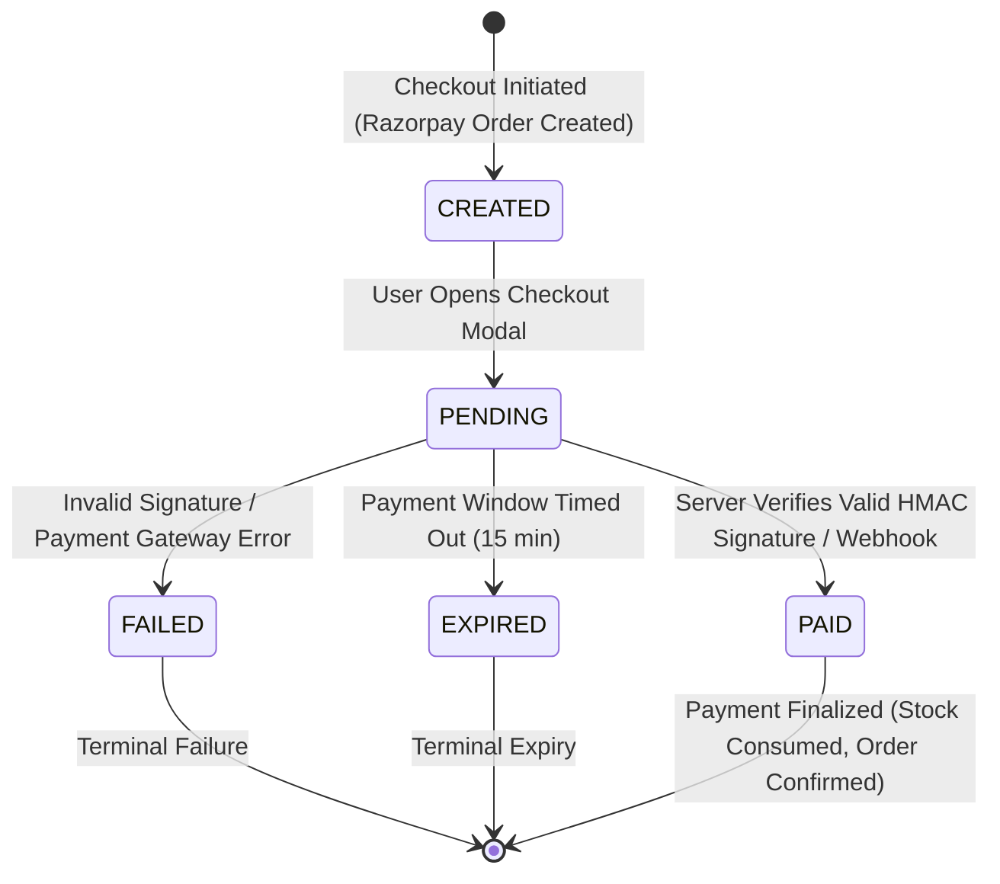
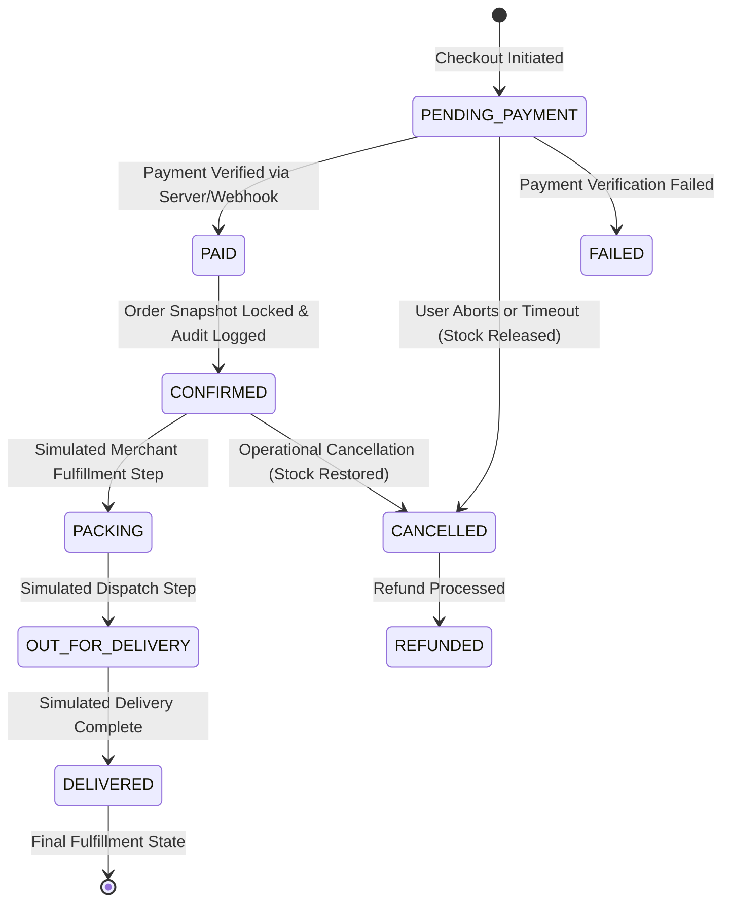
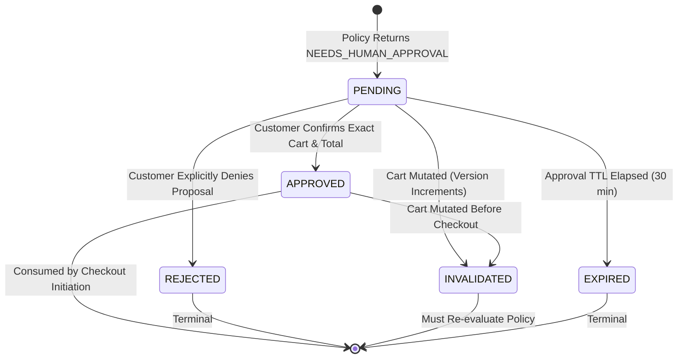
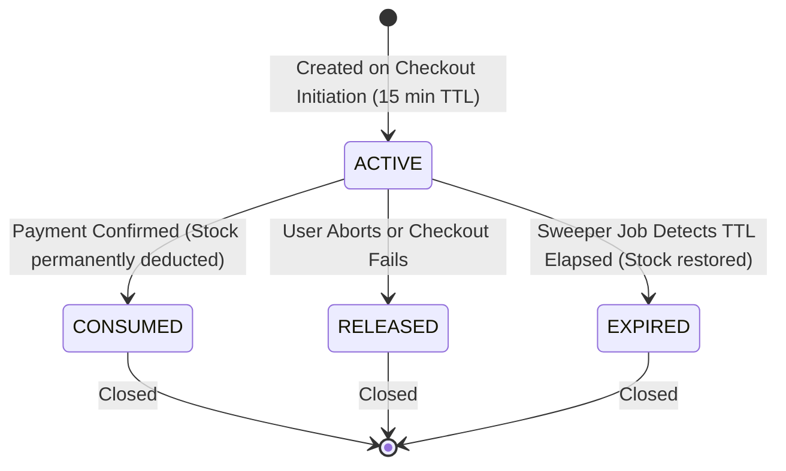

# CartPilot — Payment, Order & Approval State Machines

This document specifies the formal state machines, transition invariants, idempotency guarantees, and lifecycle rules governing Payments, Orders, Approvals, and Stock Reservations.

---

## 1. State Machine Diagrams

### 1.1. Payment Lifecycle State Machine

### 1.2. Order Lifecycle State Machine

### 1.3. Human Approval Lifecycle State Machine

### 1.4. Stock Reservation Lifecycle State Machine

---

## 2. Transition Rules & Invariants Matrix

### 2.1. Payment Transitions

| Current State | Event / Trigger        | Guard Conditions                           | Next State | Consequential Side Effects                                                       |
| :------------ | :--------------------- | :----------------------------------------- | :--------- | :------------------------------------------------------------------------------- |
| `[*] `        | `CHECKOUT_INITIATED`   | Cart valid, approval valid, stock reserved | `CREATED`  | Generates `razorpay_order_id`, records audit event.                              |
| `CREATED`     | `PAYMENT_MODAL_OPENED` | Client initiates checkout UI               | `PENDING`  | None.                                                                            |
| `PENDING`     | `SIGNATURE_VERIFIED`   | Server HMAC matches `razorpay_signature`   | `PAID`     | Transitions Order to `PAID`, marks reservation `CONSUMED`, appends to audit log. |
| `PENDING`     | `SIGNATURE_FAILED`     | HMAC mismatch or gateway error callback    | `FAILED`   | Marks reservation `RELEASED`, returns stock to inventory.                        |
| `PENDING`     | `TTL_EXPIRED`          | 15 minutes elapsed without confirmation    | `EXPIRED`  | Sweeper marks reservation `EXPIRED`, restores stock.                             |

### 2.2. Order Transitions

| Current State      | Event / Trigger     | Guard Conditions                            | Next State         | Consequential Side Effects                                          |
| :----------------- | :------------------ | :------------------------------------------ | :----------------- | :------------------------------------------------------------------ |
| `[*] `             | `CREATE_ORDER`      | Stock reserved, gateway order created       | `PENDING_PAYMENT`  | Freezes cart snapshot, address snapshot, and pricing.               |
| `PENDING_PAYMENT`  | `PAYMENT_SUCCESS`   | Linked Payment transitions to `PAID`        | `PAID`             | Logs `PAYMENT_VERIFIED` in audit trail.                             |
| `PAID`             | `AUTO_CONFIRM`      | Payment confirmed                           | `CONFIRMED`        | Emits order confirmation notification; updates customer order list. |
| `CONFIRMED`        | `SIMULATE_PACKING`  | Background worker or demo step              | `PACKING`          | Audit log record created.                                           |
| `PACKING`          | `SIMULATE_DISPATCH` | Background worker or demo step              | `OUT_FOR_DELIVERY` | Audit log record created.                                           |
| `OUT_FOR_DELIVERY` | `SIMULATE_DELIVERY` | Background worker or demo step              | `DELIVERED`        | Order marked completed; audit log record created.                   |
| `PENDING_PAYMENT`  | `PAYMENT_FAILED`    | Payment transitions to `FAILED` / `EXPIRED` | `CANCELLED`        | Order closed; stock reservation released.                           |

---

## 3. Strict Architectural Invariants

1. **Unverified Payment Invariant:** Under zero circumstances can a client-asserted callback or frontend state change an order or payment to `PAID`. Transitions to `PAID` require strict server-side HMAC cryptographic signature verification or verified webhook processing.
2. **Idempotency Invariant:** Webhooks and verification endpoints must be strictly idempotent. If the same `event_id` or `(orderId, paymentId)` combination is received multiple times:
   - The system verifies the record exists in `ProcessedWebhookEvent`.
   - The endpoint immediately returns HTTP 200 without executing repeat state mutations, notifications, or stock operations.
3. **No Terminal Mutation Invariant:** Once a payment is in `PAID`, `FAILED`, or `EXPIRED`, its state is immutable. A customer retry creates a **new** payment attempt (`Payment` record), preserving historical attempts.
4. **Stock Consistency Invariant:**
   - Active reservations temporarily decrement `availableStock` and increment `reservedStock`.
   - When a payment becomes `PAID`, `reservedStock` is decremented (stock is permanently consumed).
   - If payment expires or fails, `reservedStock` is decremented and `availableStock` is incremented.
   - Sum of `availableStock + reservedStock` always remains constant.
5. **Approval Version Invariant:**
   - If `cart.version` does not match `approval.cartVersion`, the approval is automatically considered invalid.
   - An approval cannot be applied to a cart with different items or a modified total.
