# CartPilot — System Architecture & Component Design

This document details the high-level system architecture, core runtime components, and architectural philosophy of CartPilot (Agent Commerce Gateway).

---

## 1. Architectural Philosophy: The Modular Monolith

CartPilot is designed as a **Modular Monolith**. The frontend (React/Vite), backend (Node.js/Express/TypeScript), database (MongoDB Atlas), LLM provider (OpenAI/Anthropic/Gemini API via adapter), and payment gateway (Razorpay Test Mode) are distinct operational tiers, but all commerce, policy, agent orchestration, and audit capabilities run within a single cohesive backend process.

### Why a Modular Monolith?

1. **Zero Distributed Systems Tax:** Avoids network latency, partial failures, distributed transactions (two-phase commits), and complex service mesh overhead during development and evaluation.
2. **Strict Module Boundaries:** Clean code decoupling is maintained via TypeScript interfaces, isolated domain folders, and explicit exported services.
3. **Transactional Integrity:** MongoDB transactions and atomic document mutations can be executed across inventory, cart, and payment state without distributed sagas.
4. **Focused Security Surface:** A unified API gateway and security boundary means authentication, rate limiting, and RBAC are enforced uniformly at one ingress point.
5. **Direct Path to Decomposition:** Because modules adhere strictly to domain separation, any individual domain (e.g., Catalog or Audit) can be extracted into an independent microservice later if production scaling demands it.

---

## 2. High-Level Component Architecture

```mermaid
graph TD
    subgraph Clients ["Client Applications"]
        CustomerUI["Customer Web App\n(React + Vite + Tailwind)"]
        MerchantUI["Merchant Portal\n(React + Vite)"]
        AdminUI["Admin & Audit Console\n(React + Vite)"]
    end

    subgraph API_Gateway ["API Boundary (Express + TypeScript)"]
        Ingress["Reverse Proxy / Express Router\n(/api/v1/*)"]
        Security["Auth & RBAC Middleware\n(JWT, Rate Limiting, CORS)"]
    end

    subgraph Backend_Modules ["Modular Backend Core"]
        AuthMod["Auth & User Module"]
        CatalogMod["Catalog & Search Module"]
        CartMod["Cart & Versioning Module"]
        PricingMod["Authoritative Pricing Service\n(Integer Paise)"]
        InventoryMod["Inventory & Reservation Service"]
        PolicyMod["Deterministic Spending Policy Engine\n(Non-LLM)"]
        ApprovalMod["Cryptographic Approval Service"]
        CheckoutMod["Checkout Orchestrator"]
        OrderMod["Order State Machine & Snapshots"]
        PaymentMod["Payment Gateway Integration Service"]
        AgentMod["AI Agent Orchestrator\n(Tool Sandbox & Guardrails)"]
        AuditMod["Tamper-Evident Audit Service\n(SHA-256 Hash Chain)"]
    end

    subgraph External_Services ["External Providers & Infrastructure"]
        LLMProvider["LLM API Provider\n(Structured Tool Calling)"]
        RazorpayGateway["Razorpay Payment Gateway\n(Test Mode)"]
        MongoAtlas[("MongoDB Atlas\nPrimary Document Store")]
    end

    subgraph Background_Workers ["Node.js Scheduled Jobs"]
        ExpiryJob["Reservation Expiry Sweeper (60s)"]
        DeliverySim["Delivery Lifecycle Simulator (30s)"]
    end

    %% Client Interactions
    CustomerUI -->|HTTPS REST / SSE| Ingress
    MerchantUI -->|HTTPS REST| Ingress
    AdminUI -->|HTTPS REST| Ingress

    %% API Ingress
    Ingress --> Security
    Security --> AuthMod
    Security --> CatalogMod
    Security --> CartMod
    Security --> CheckoutMod
    Security --> OrderMod
    Security --> ApprovalMod
    Security --> AgentMod
    Security --> AuditMod

    %% Inter-module Collaborations
    AgentMod -->|Bounded Tool Calls| CatalogMod
    AgentMod -->|Propose Cart Items| CartMod
    CartMod --> PricingMod
    CheckoutMod --> PricingMod
    CheckoutMod --> InventoryMod
    CheckoutMod --> PolicyMod
    CheckoutMod --> ApprovalMod
    CheckoutMod --> PaymentMod
    CheckoutMod --> OrderMod

    %% Persistence & External
    CatalogMod --> MongoAtlas
    CartMod --> MongoAtlas
    InventoryMod --> MongoAtlas
    OrderMod --> MongoAtlas
    AuditMod --> MongoAtlas

    AgentMod -->|HTTPS Tool Schema| LLMProvider
    PaymentMod -->|HTTPS Orders API| RazorpayGateway
    RazorpayGateway -->|Webhook Callbacks| Ingress

    %% Workers
    ExpiryJob --> InventoryMod
    DeliverySim --> OrderMod
```



---

## 3. The Core Operating Cycle

Every interaction in the system enforces the core architectural axiom:

$$\text{AI Proposes} \longrightarrow \text{Backend Validates} \longrightarrow \text{Policy Engine Decides} \longrightarrow \text{Commerce Service Executes} \longrightarrow \text{Audit Service Records}$$

### Phase Breakdown

1. **AI Proposes:**
   - The user asks: _"Prepare ingredients for Paneer Pulao for 4 people under ₹600."_
   - The AI Agent invokes the allowlisted tool `searchCatalog` or `resolveRecipe`.
   - The LLM receives catalog metadata (names, pack units, prices) and returns a structured cart proposal JSON.
   - **Crucial Rule:** The LLM's proposal is strictly uncommitted and non-binding.

2. **Backend Validates:**
   - The Cart and Pricing services take the suggested product IDs and quantities.
   - Quantities are checked against real stock levels.
   - Prices are fetched directly from MongoDB database records.
   - The authoritative total is calculated strictly in integer paise:
     $$\text{TotalPaise} = \sum (\text{PricePaise}_i \times \text{Qty}_i) + \text{DeliveryFeePaise} + \text{TaxPaise}$$
   - Any client-submitted total is ignored.

3. **Policy Engine Decides:**
   - The spending policy engine evaluates the cart total against the user's active mandate:
     - Is `totalPaise <= mandate.maxOrderAmountPaise`?
     - Does `todaySpentPaise + totalPaise <= mandate.dailyBudgetPaise`?
     - Are all items from `mandate.allowedMerchantIds`?
     - Are any items in `mandate.blockedCategories`?
   - Engine returns a deterministic status:
     - `ALLOW`: Directly eligible for checkout.
     - `NEEDS_HUMAN_APPROVAL`: Purchase requires explicit cryptographic customer sign-off.
     - `DENY`: Hard rejection; order cannot proceed.

4. **Commerce Service Executes:**
   - When eligible, the Checkout Orchestrator:
     - Verifies approval token hash matches current cart version and price.
     - Atomically decrements `availableStock` and records `StockReservation` with a 15-minute TTL.
     - Creates a Razorpay order via the test gateway API.
     - Presents the Razorpay test modal to the user.
     - Awaits client completion and server-side HMAC signature verification or webhook confirmation.
     - Transitions order to `PAID` and `CONFIRMED`.

5. **Audit Service Records:**
   - Every significant milestone (proposal, policy decision, approval, reservation, payment verification, status transition) is serialized and appended to the SHA-256 hash-chained audit ledger.
   - Historical records are immutable.

---

## 4. Architectural Boundaries & Trust Zones

```
+--------------------------------------------------------------------------+
| UNTRUSTED ZONE                                                           |
| - User Browser / React Frontend (can be modified, inspected, faked)     |
| - LLM Provider Output (can hallucinate, fail, inject prompt text)        |
+--------------------------------------------------------------------------+
                                    │
                         [Strict Ingress Barrier]
                         - JWT Authentication
                         - Zod Schema Validation
                         - Rate Limiting
                                    ▼
+--------------------------------------------------------------------------+
| TRUSTED COMMERCE ZONE (Modular Backend Core)                              |
| - Authoritative Pricing Service (DB prices only, integer paise)         |
| - Deterministic Policy Engine (independent rule engine)                  |
| - Stock Reservation Engine (atomic MongoDB operations)                   |
| - Payment Verification (HMAC-SHA256 signature checking)                 |
| - Hash-Chained Audit Ledger (append-only)                                |
+--------------------------------------------------------------------------+
                                    │
                                    ▼
+--------------------------------------------------------------------------+
| PERSISTENCE & GATEWAYS                                                   |
| - MongoDB Atlas (State of Record)                                        |
| - Razorpay Test Gateway (Payment Authority)                              |
+--------------------------------------------------------------------------+
```
