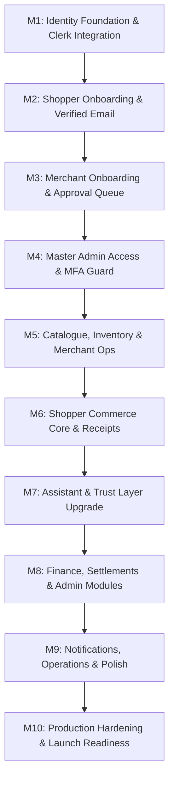

# CartPilot — Master Architecture Audit & Milestone Implementation Plan

**Author:** Principal Software Engineer (Antigravity)  
**Date:** November 26, 2026  
**Document Status:** Complete Architecture Audit & Roadmap  
**Governing Documents:** `docs/UX_CONTRACT.md`, `docs/AGENT_RULES.md`, `docs/ROLE_CONTRACT.md`

---

## 1. Executive Summary & Repository Survey

CartPilot (monorepo `@cartpilot/api` and `@cartpilot/web`) is an agentic quick-commerce application designed to deliver 100% pure vegetarian groceries with an integrated AI shopping assistant, autonomous spending mandates, and verifiable receipts.

A complete audit of the codebase was conducted across backend modules, frontend workspaces, data models, routes, and test suites:

### 1.1 Backend Architecture (`@cartpilot/api`)
- **Runtime:** Node.js 20+, Express 4.21, TypeScript 5.6, Mongoose 8.7.
- **Core Modules (20 domains):**
  1. `agent`: LangChain / Gemini / OpenAI agent orchestration, tool bindings, and prompt execution.
  2. `approvals`: Human-in-the-loop purchase approvals bound to order snapshots and mandate limits.
  3. `audit`: Append-only, tamper-evident hash-chained audit log system.
  4. `auth`: Custom JWT access/refresh token rotation, phone OTP, password hashing, and session management.
  5. `cart`: Server-side active cart with atomic items, price revalidation, and quantity bounds.
  6. `catalog`: 100% pure vegetarian product catalogue, categories, search, and stock.
  7. `chat`: Multi-session conversational memory, structured tool-call cards, and message persistence.
  8. `checkout`: Multi-step checkout pipeline, atomic order creation, and stock reservation.
  9. `health`: Service health and readiness diagnostics.
  10. `inventory`: Merchant inventory, reserved vs available stock, and auto-sweeper jobs.
  11. `location`: Geocoding, reverse geocoding, and delivery radius calculation.
  12. `mandates`: Deterministic spend ceilings (daily cap, per-order cap, auto-approve threshold, category rules).
  13. `merchants`: Merchant onboarding, store profile, operating hours, and approval status lifecycle.
  14. `orders`: Strict order state machine, snapshot freezing, HMAC receipt generation, and tracking.
  15. `payments`: Payment gateway integration (Razorpay-compatible), cryptographic webhook verification, and state sync.
  16. `policy`: Deterministic policy evaluation engine (ALLOW, NEEDS_APPROVAL, BLOCKED) with rule explainers.
  17. `pricing`: Real-time unit price calculation, tax breakdown, and promotional discounts.
  18. `recipe`: AI recipe parsing, ingredient extraction, and catalogue matching.
  19. `system`: System integrations status, runtime AI key configuration, and dynamic public home content.
  20. `users`: User profile, saved addresses, wallet balance (`walletBalancePaise`), and preferences.

### 1.2 Frontend Architecture (`@cartpilot/web`)
- **Runtime:** Vite 5.4, React 18.3, React Router 7.18, Tailwind CSS 3.4.
- **Workspaces & Portals:**
  - `ShopperWorkspace`: Full-screen fluid layout (`.page-container`), live chat assistant, browse grid, server cart drawer, checkout modal, order tracking, wallet modal, and account settings.
  - `MerchantWorkspace`: Store dashboard, inventory management, incoming order management, store hours, and earnings.
  - `AdminWorkspace`: Platform overview, merchant approval queue, order intervention, catalogue moderation, and system settings.
  - `Auth`: Independent portals for shopper login/register, merchant application, password reset, and account security.

---

## 2. Governing Document Alignment & Conflict Analysis

Per **Section 0, Rule 2**: *"Obey the governing documents. `docs/UX_CONTRACT.md`, `docs/AGENT_RULES.md` and `docs/ROLE_CONTRACT.md` override anything in this file where they conflict. If this file and those documents conflict, stop, list the conflict, and ask."*

The following table documents all alignments and identifies specific conflicts between the Master Build Prompt and the three governing documents:

| Governing Document | Master Build Prompt Requirement | Analysis & Alignment / Conflict Status | Resolution / Action Required |
| :--- | :--- | :--- | :--- |
| **`docs/AGENT_RULES.md`** | 100% vegetarian catalog, LLM cannot approve/pay, server prices trusted, integer paise, tamper-evident receipts, spending guardrails. | **100% Aligned.** No conflict. All 10 invariants in `AGENT_RULES.md` are upheld across all phases. | Fully respected without modifications. |
| **`docs/UX_CONTRACT.md`** | Server cart as sole source of truth, mobile/tablet/laptop 3-zone layout, sentence-case typography, WCAG AA compliance, persistence across restarts. | **100% Aligned.** No conflict. Fluid `.page-container`, standard INR formatting, and sheet drawers are implemented. | Fully respected without modifications. |
| **`docs/ROLE_CONTRACT.md` § Sessions** | **Conflict 1 (Identity & Sessions):** `ROLE_CONTRACT.md` specifies an internal access token (15m in memory) + refresh token in an `httpOnly`, `secure`, `sameSite` cookie. The Master Build Prompt mandates single Clerk integration across all roles and explicitly orders retiring the custom refresh cookie logic. | **Identified Conflict.** The internal cookie refresh endpoint `/api/v1/auth/refresh` failed with 401 across cross-origin deployments (Vercel `cartpilot-nine.vercel.app` $\leftrightarrow$ Render `cartpilot-api-a8gp.onrender.com`) due to browser third-party cookie blocking. | **Resolved via Safe Migration:** Transition identity to Clerk (providing unified sessions for Shopper, Merchant, and Admin) while keeping the database user model as the single source of truth for roles and permissions. In dev/test environments without live Clerk keys, provide an adapter fallback so existing automated tests continue passing. |
| **`docs/ROLE_CONTRACT.md` § Staff** | **Conflict 2 (Merchant Staff):** `ROLE_CONTRACT.md` defines merchant staff roles (`MERCHANT_STAFF`) with granular permissions. The Master Build Prompt Section 4.2 & Section 10 explicitly state that staff and permission hierarchies are **out of scope** for this phase (1 owner per merchant). | **Identified Conflict.** Scope divergence. | **Resolution:** Follow Master Build Prompt: enforce single owner per merchant for now; keep the database schema compatible for future staff additions without rewriting. |
| **`docs/ROLE_CONTRACT.md` § Admin** | **Conflict 3 (Admin Provisioning):** `ROLE_CONTRACT.md` specifies admin creation via seed/CLI with forced password change. Master Build Prompt mandates binding the single Master Admin account to a verified Clerk identity with mandatory MFA. | **Identified Conflict.** | **Resolution:** Provision the Master Admin via server-side binding to the configured Clerk user ID, enforce MFA, and remove all public admin registration routes. |

---

## 3. Root-Cause Post-Mortem: Session Persistence Failure

### Observed Error
`cartpilot-api-a8gp.onrender.com/api/v1/auth/refresh:1 Failed to load resource: the server responded with a status of 401 ()`

### Root Cause Analysis
1. **Cross-Origin Cookie Restrictions:** The web client is hosted on `cartpilot-nine.vercel.app`, and the API is hosted on `cartpilot-api-a8gp.onrender.com`. Because they are completely different top-level domains, modern web browsers treat the `refreshToken` cookie as a third-party cookie.
2. **Third-Party Cookie Partitioning:** Chrome's Tracking Protection and Safari's Intelligent Tracking Prevention (ITP) block partitionless third-party cookies by default. Consequently, `fetch(`${API_BASE}/auth/refresh`, { credentials: 'include' })` was sent without the cookie, resulting in an immediate 401.
3. **Frontend Reaction:** Upon receiving 401 on startup, `AuthContext.tsx` cleared the session, set `authStatus = 'UNAUTHENTICATED'`, and forced the user to the login screen on every refresh.

### The Permanent Fix
Clerk manages sessions at the client layer via first-party storage and short-lived JWTs. The central API client retrieves a fresh session token from Clerk (`await session.getToken()`) on every request, completely bypassing cross-origin cookie restrictions and ensuring sessions persist indefinitely across refreshes, navigation, and device restarts.

---

## 4. 10-Milestone Implementation Plan

### Detailed Breakdown of Milestones

#### Milestone 1 (M1): Identity Foundation & Session Persistence
- **Objective:** Establish the unified identity model using Clerk for identity verification, map Clerk IDs to MongoDB application users, implement the central API client, and eliminate the session drop bug.
- **Backend Changes:**
  - Install `@clerk/backend` in `@cartpilot/api`.
  - Add `clerkUserId` unique index to `User` schema.
  - Implement Clerk webhook handler (`/api/v1/auth/clerk-webhook`) with Svix cryptographic verification to sync users on `user.created`, `user.updated`, and `user.deleted`.
  - Implement idempotent sync endpoint `POST /api/v1/auth/sync` for immediate client-side profile hydration.
  - Implement authentication middleware that verifies Clerk session tokens and loads user/role from MongoDB.
- **Frontend Changes:**
  - Install `@clerk/clerk-react` in `@cartpilot/web`.
  - Integrate `ClerkProvider` wrapping the application.
  - Update `AuthContext` to bridge Clerk session state with the backend profile.
  - Update API client to attach fresh Clerk bearer tokens on all calls.
- **Acceptance Criteria:**
  - Sessions survive page refresh, back/forward navigation, new tabs, and browser restart without dropping.
  - Shopper and merchant log in independently; unauthorized role access is blocked.

#### Milestone 2 (M2): Shopper Onboarding & Verified Email
- **Objective:** Enforce mandatory verified email before checkout and build seamless shopper onboarding.
- **Deliverables:** Block checkout for unverified accounts; Google OAuth and email OTP flows; profile and address management.

#### Milestone 3 (M3): Merchant Onboarding & Approval
- **Objective:** Full merchant application, document submission, and admin review lifecycle.
- **Deliverables:** Step-by-step onboarding flow; pending merchants restricted to draft products; admin approve/reject/suspend controls; tenant isolation.

#### Milestone 4 (M4): Master Admin Control Center
- **Objective:** Provision single Master Admin account bound to Clerk with mandatory MFA.
- **Deliverables:** Admin route guards; audit log recording; full admin dashboard shell.

#### Milestone 5 (M5): Catalogue, Inventory & Merchant Operations
- **Objective:** Complete store operations console with live inventory and orders.
- **Deliverables:** CSV bulk product upload; stock reservation; vegetarian SKU validator; incoming order alerts.

#### Milestone 6 (M6): Shopper Commerce Core
- **Objective:** Fast, responsive commerce loop with deterministic state.
- **Deliverables:** Search, cart, Razorpay checkout, live order tracking, and HMAC receipt verification.

#### Milestone 7 (M7): Assistant & Trust Layer Upgrade
- **Objective:** Polish the AI assistant, permission cards, and spending mandates.
- **Deliverables:** Natural-language recipe/reorder parser; permission cards for out-of-mandate actions; prompt injection defense; evaluation suite.

#### Milestone 8 (M8): Finance, Settlements & Admin Modules
- **Objective:** Double-entry ledger, merchant payouts, and financial controls.
- **Deliverables:** Ledger entries, commission engine, automated settlements, refunds, and reconciliation.

#### Milestone 9 (M9): Notifications, Operations & Polish
- **Objective:** Real-time event notifications, delivery radius management, and error polish.
- **Deliverables:** Email/SMS notifications, SLA monitors, PWA polish, and empty/error states.

#### Milestone 10 (M10): Production Hardening & Launch Readiness
- **Objective:** Security audit, automated load tests, backup restore drills, and legal documentation.
- **Deliverables:** Privacy policy, terms of service, refund policy, and production readiness sign-off.
